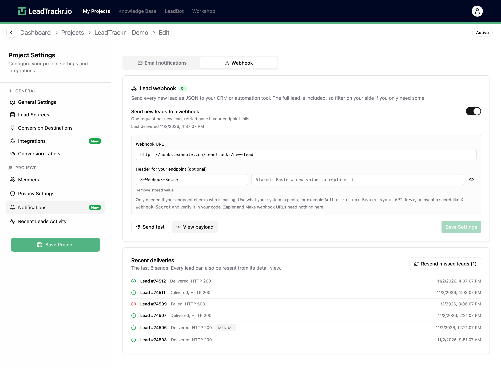
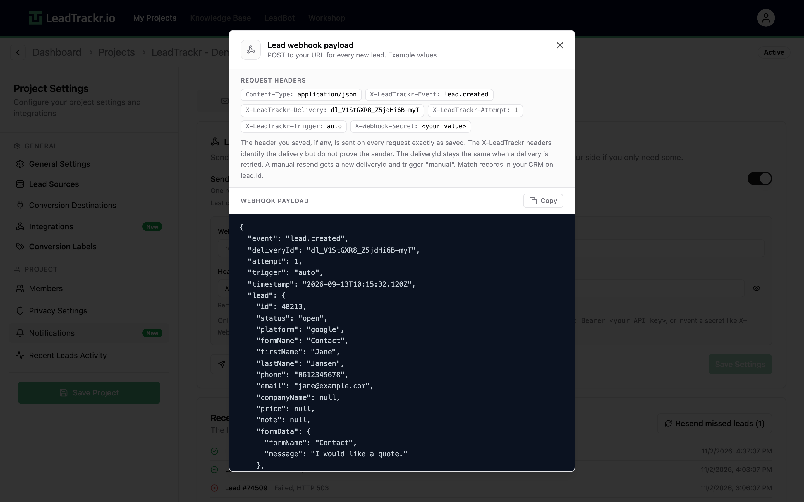
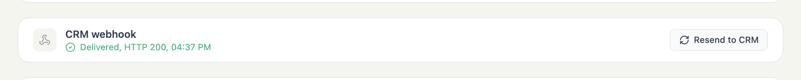

The lead webhook sends every new lead to a URL you choose, the moment it comes in. You use it to create a contact or deal in your CRM, directly or through an automation tool such as n8n, Make, or Zapier.

Each request contains the full lead: contact details, form data, click IDs, and the channel flow. Your sales team gets the lead in the CRM they already work in. Your CRM keeps the LeadTrackr lead ID, so when the deal moves forward you can send that status back to LeadTrackr as an offline conversion.

<Note>
  The lead webhook is available on the **Growth** and **Pro** plans. Only platform admins, the project owner, and project admins can change it.
</Note>

## How it works

<Steps>
  <Step title="A lead comes in">
    A form, call, or other lead source creates a new lead in LeadTrackr
  </Step>
  <Step title="LeadTrackr sends the lead">
    LeadTrackr sends a `POST` request with the lead as JSON to your webhook URL
  </Step>
  <Step title="Your CRM creates the record">
    Your endpoint or automation creates a contact or deal and stores `lead.id`
  </Step>
  <Step title="Send the result back">
    When the deal progresses, your CRM calls [Update Lead Status](/api-reference/leads/update-lead-status) with that `lead.id`. LeadTrackr then sends the conversion to your ad platforms
  </Step>
</Steps>

## Step 1: Get a webhook URL

You need a URL that accepts a `POST` request with a JSON body. Where you get it depends on your setup:

- **n8n**: add a **Webhook** node, set the method to `POST`, and copy the production URL
- **Make**: add a **Custom webhook** trigger and copy its address
- **Zapier**: start a Zap with **Webhooks by Zapier** → **Catch Hook** and copy the URL
- **Your own endpoint**: any public HTTPS endpoint that returns a `2xx` status code

The URL must meet these requirements:

- It starts with `https://`
- It points to a public host, not `localhost` or a private network address
- It contains no username or password. Put credentials in the header instead (see Step 2)
- It doesn't redirect. LeadTrackr doesn't follow redirects, so use the final URL

## Step 2: Turn on the webhook in LeadTrackr

1. Go to your **Project Settings**
2. Open the **Notifications** tab
3. Click the **Webhook** tab
4. Turn on **Send new leads to a webhook**
5. Paste your URL into **Webhook URL**
6. Optional: add a **Header for your endpoint**, for example `Authorization` with `Bearer your-token`, or a secret of your own such as `X-Webhook-Secret`
7. Click **Save Settings**

<Frame>
  
</Frame>

<Tip>
  Use the header when your endpoint checks who is calling. Store the same secret in your endpoint and reject requests that don't send it. Zapier and Make webhook URLs already contain a secret, so they need no header.
</Tip>

The header value is stored encrypted. After saving, the field shows **Stored. Paste a new value to replace it**.

## Step 3: Send a test

Click **Send test** after saving. LeadTrackr sends a test lead to your URL and shows the response from your endpoint.

The test lead never contains real data. It has `"id": 0`, the form name `Webhook test`, the email `test@example.com`, and `"trigger": "test"`. Use it to map fields in your automation tool, then filter it out (see [Map the fields](#step-4-map-the-fields-in-your-crm)).

## Step 4: Map the fields in your CRM

Click **View payload** to see the request headers and an example body.

<Frame>
  
</Frame>

Every new lead is sent as one request:

```json
{
  "event": "lead.created",
  "deliveryId": "dl_V1StGXR8_Z5jdHi6B-myT",
  "attempt": 1,
  "trigger": "auto",
  "timestamp": "2026-11-02T10:15:32.120Z",
  "lead": {
    "id": 48213,
    "status": "open",
    "platform": "google",
    "formName": "Contact Form",
    "firstName": "John",
    "lastName": "Doe",
    "phone": "+31612345678",
    "email": "john@example.com",
    "companyName": "Acme Inc.",
    "price": null,
    "note": null,
    "formData": {
      "formName": "Contact Form",
      "message": "I would like a quote."
    },
    "userData": {
      "firstName": "John",
      "lastName": "Doe",
      "email": "john@example.com",
      "phone": "+31612345678"
    },
    "attributionData": {
      "gclid": "abc123",
      "cid": "1234567890.1234567890",
      "conversionPage": "www.example.com/contact"
    },
    "channelFlow": [
      {
        "timestamp": 1793613032120,
        "channel": { "source": "google", "medium": "cpc", "campaign": "Brand NL" },
        "landingPage": "/contact"
      }
    ],
    "uniqueIdentifier": null,
    "createdAt": "2026-11-02T10:15:31.000Z"
  }
}
```

The `lead` object has the same fields as the [Get Lead](/api-reference/leads/get-lead) response. The full lead is always sent, so pick the fields you need on your side.

| Field | Use it for |
|---|---|
| `lead.id` | Store it on the CRM record. You need it to send the status back and to prevent duplicates |
| `lead.firstName`, `lead.lastName`, `lead.email`, `lead.phone`, `lead.companyName` | The contact and company in your CRM |
| `lead.formName` | Which form the lead came from, for example to choose a pipeline or deal stage |
| `lead.formData` | All form fields as they were submitted, including custom fields |
| `lead.channelFlow` | The visits before the conversion. Use the first and last step for first click and last click source, medium, and campaign fields |
| `lead.attributionData` | Click IDs such as `gclid`, plus the page where the lead converted |
| `trigger` | `auto` for new leads, `manual` for a resend, `test` for a test |

<Warning>
  Skip test deliveries in your automation. Only continue when `trigger` isn't `test` (or when `lead.id` is greater than `0`). Otherwise every test creates a record in your CRM.
</Warning>

### Request headers

Every request carries these headers, plus your own header if you set one:

| Header | Value |
|---|---|
| `Content-Type` | `application/json` |
| `User-Agent` | `LeadTrackr-Webhook/1.0` |
| `X-LeadTrackr-Event` | `lead.created` |
| `X-LeadTrackr-Delivery` | The `deliveryId` |
| `X-LeadTrackr-Attempt` | `1` or `2` |
| `X-LeadTrackr-Trigger` | `auto`, `manual`, or `test` |

The `X-LeadTrackr-*` headers identify a delivery, but they don't prove who sent it. Use your own header to authenticate requests.

### Prevent duplicate records

The same lead can reach your endpoint more than once, for example when a retry arrives after a slow first attempt, or when someone resends it by hand.

- A retry keeps the same `deliveryId`
- A manual resend gets a new `deliveryId` and `"trigger": "manual"`

Match records in your CRM on `lead.id`. If a record with that ID already exists, update it or skip it instead of creating a new one.

## Step 5: Send the deal status back to LeadTrackr

Store `lead.id` in a field on the contact or deal. When the deal reaches a stage you want to report to your ad platforms, such as an appointment, a proposal, or a won deal, let your CRM or automation call [Update Lead Status](/api-reference/leads/update-lead-status) with that `leadId` and the matching [conversion label](/conversion-labels/set-up-conversion-labels).

LeadTrackr then sends the offline conversion to Google Ads, Meta, and your other [conversion destinations](/integrations/google-ads). The ad platforms learn which campaigns bring in deals instead of form fills.

<Tip>
  **Example:** a B2B company sends every new lead through the webhook to n8n. n8n creates a contact and a deal in Teamleader, with the first and last click from `channelFlow` in custom fields. When a deal moves to the **Proposal sent** phase, n8n calls Update Lead Status with the stored lead ID. LeadTrackr sends the conversion to Google Ads, Meta, and LinkedIn.
</Tip>

## Delivery, retries, and pauses

LeadTrackr tries to deliver every lead twice at most:

1. **First attempt**: right after the lead comes in, with a 4 second timeout
2. **One retry**: 2 minutes later, with a 10 second timeout

Your endpoint must reply with a `2xx` status code within that time. Do the slow work, such as CRM calls, after you reply, or use an automation tool that replies straight away.

| Response | What LeadTrackr does |
|---|---|
| `2xx` | Delivered |
| `408`, `425`, `429`, `5xx`, timeout, network error | Retries once |
| Other `4xx` | Failed, no retry |
| `3xx` redirect | Failed, no retry. Use the final URL |

After **10 leads in a row** fail, LeadTrackr pauses the webhook and shows the last error in the settings. New leads are then not sent. Fix your endpoint and click **Resume**. Changing the URL or the header also resumes the webhook.

### Resend leads

- **Resend missed leads**: in the **Recent deliveries** list, this button queues the newest failed or skipped leads again, up to 500 at a time. They are sent within a minute
- **Resend to CRM**: every lead shows its webhook status in the lead details. Click **Resend to CRM** to send that one lead again

<Frame>
  
</Frame>

**Recent deliveries** shows the last 10 sends with their status code. The delivery log keeps no lead data and is deleted after 90 days.

## When a lead is not sent

The webhook fires once, for `lead.created`. It doesn't fire when:

- A repeat submission from the same person is [merged into an existing lead](/changelog) by lead matching. The CRM already has that lead
- A submission is an exact duplicate of an existing lead
- Leads are added through a lead import
- The webhook is turned off or paused, or the project's plan doesn't include webhooks. These leads show as **Not sent** and you can resend them later

Status changes aren't sent through the webhook. Your CRM leads the deal, and LeadTrackr receives the status through the API.

## Troubleshooting

| Problem | Solution |
|---|---|
| **Failed, HTTP 401 or 403** | Your endpoint rejects the header. Check the header name and value, then send a test |
| **Failed, HTTP 404** | The URL is wrong, or your n8n workflow isn't active. In n8n, use the production URL, not the test URL |
| **Timeout** | Your endpoint replies too slowly. Reply first, then process the lead |
| **Redirected (HTTP 301/302)** | Use the final URL, often with or without `www` or a trailing slash |
| **No new deals in the CRM, but deliveries succeed** | Check the filters in your automation, and whether the lead was merged into an existing lead |
| **The webhook is paused** | Fix the endpoint, click **Resume**, then click **Resend missed leads** |

## What's next?

<CardGroup cols={2}>
  <Card title="Update Lead Status" icon="arrows-rotate" href="/api-reference/leads/update-lead-status">
    Send the deal status from your CRM back to LeadTrackr
  </Card>
  <Card title="Set Up Conversion Labels" icon="tags" href="/conversion-labels/set-up-conversion-labels">
    Link CRM stages to conversion events in your ad platforms
  </Card>
</CardGroup>
