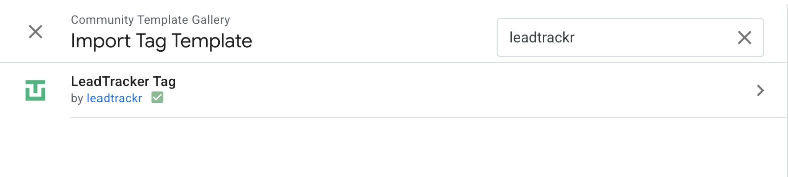
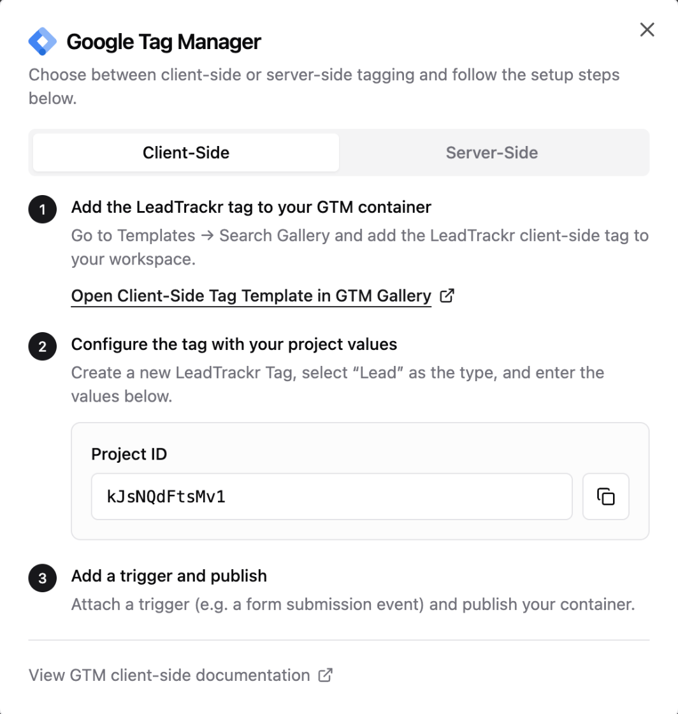
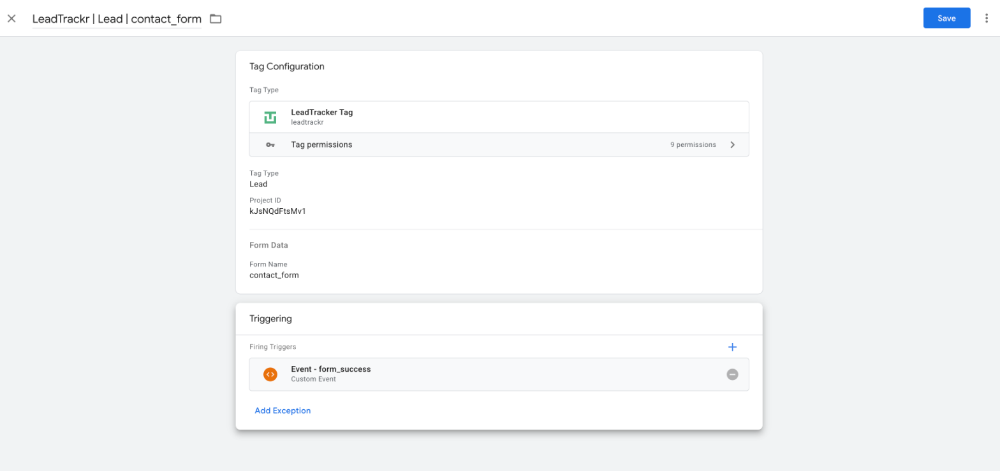

## Step 1: Add the LeadTrackr Tag to Your GTM Container

1. Go to your **web container** in Tag Manager
2. Click **Templates** → **Search Gallery**
3. Search for `leadtrackr` and open **LeadTracker Tag** (by leadtrackr)
4. Click **Add to workspace**

<Frame>
  
</Frame>

## Step 2: Create a New LeadTrackr Tag

1. Go to **Tags** and click **New**
2. Select **LeadTracker Tag** as the tag type
3. Set **Tag Type** to **Lead**
4. Fill in the required fields:
    - **Project ID**
    - **Form name** (descriptive label)
    - Any custom form fields or user data fields you want to pass along (e.g. email, phone, message)

The client-side tag does not need an API key.

<Info>If you use server-side tagging, we recommend sending requests both client and server side and adding a unique ID for deduplication.</Info>

### Where to find your project ID

1. Go to [app.leadtrackr.io/dashboard/projects](https://app.leadtrackr.io/dashboard/projects)
2. Open the project you want to connect and click **Edit Project**
3. Go to **Lead Sources** and click **Google Tag Manager**
4. Open the **Client-Side** tab and copy the **Project ID**

<Frame>
  
</Frame>

The project ID is a short code such as `kJsNQdFtsMv1`. You also see it in the URL of your project.

## Step 3: Add a Trigger

Attach a trigger that fires when a form is submitted successfully.

This is typically a **custom event** from the dataLayer, such as `form_submission` or `form_success`.

<Frame>
  
</Frame>

## Step 4: Publish Your Container

Once your tag and trigger are configured, **publish your GTM container**.

Your form submissions are now sent to LeadTrackr, ready to be rated, qualified, and pushed to ad platforms as offline conversions.

## Other Lead Source Options

<CardGroup cols={2}>
  <Card title="WordPress Forms (Recommended)" icon="wordpress" href="/lead-sources/wordpress-forms">
    Use the WordPress plugin for server-to-server tracking
  </Card>
  <Card title="Server-side GTM" icon="server" href="/lead-sources/server-side-gtm">
    Use the LeadTrackr Tag in server-side GTM
  </Card>
</CardGroup>

## What's Next?

With your lead source active, set up the Channel Flow Tracker and connect your conversion destinations.

<CardGroup cols={2}>
  <Card title="Set Up Channel Flow Tracker" icon="route" href="/lead-sources/channel-flow-tracker">
    Track the full user journey with UTM parameters
  </Card>
  <Card title="Set Up Google Ads Conversions" icon="google" href="/integrations/google-ads">
    Send offline conversions to Google Ads
  </Card>
  <Card title="Set Up Meta Integration" icon="meta" href="/integrations/meta">
    Send offline conversions to Meta (Facebook)
  </Card>
  <Card title="Set Up GA4 Integration" icon="chart-simple" href="/integrations/ga4">
    Send offline conversions to Google Analytics 4
  </Card>
</CardGroup>
