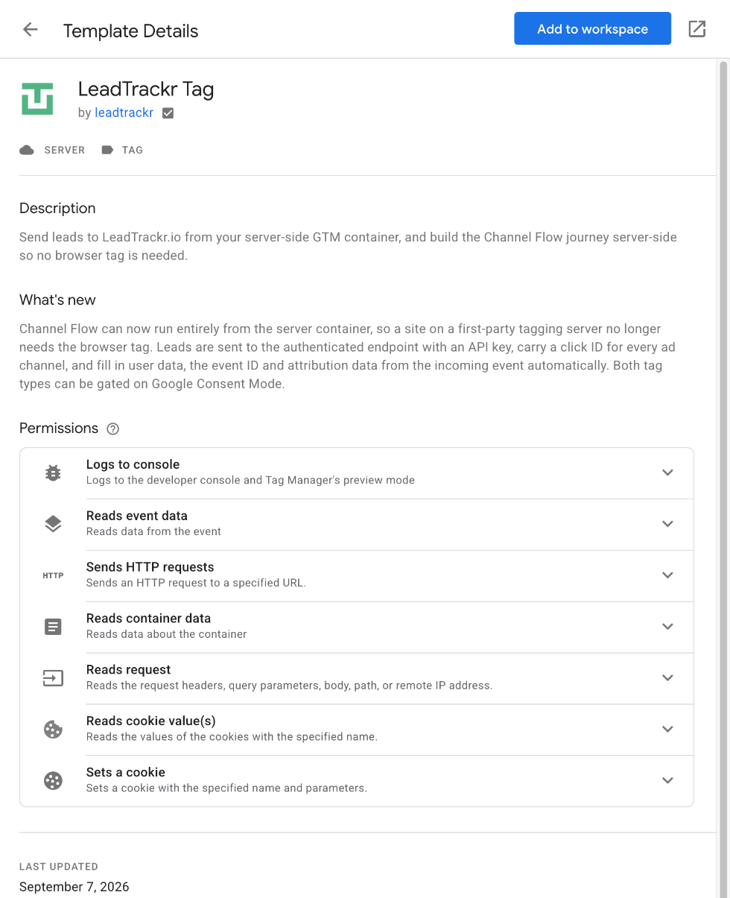
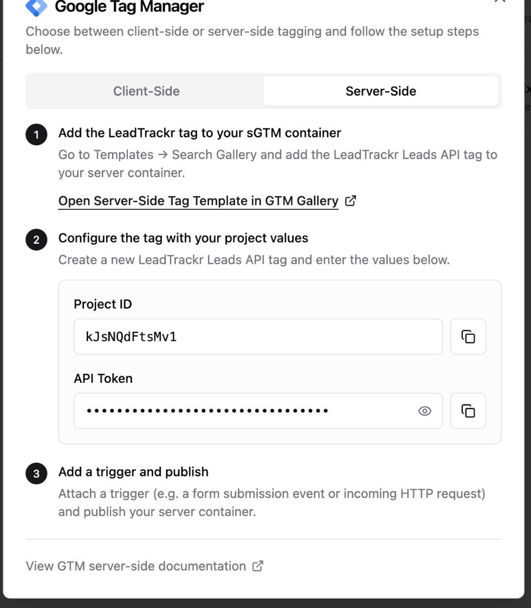
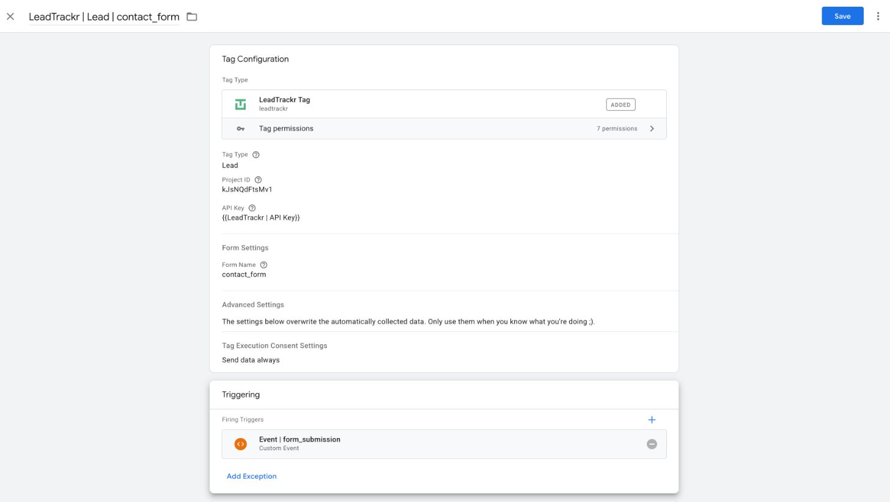

If you're not using our WordPress plugin — or your form provider isn't supported — you can send form submissions to LeadTrackr using the **Leads API tag in Server-side Google Tag Manager (sGTM)**.

<Note>
**Using WordPress?** If your form provider is supported by our [WordPress plugin](/lead-sources/wordpress-forms), we strongly recommend using it instead of the sGTM setup.

The plugin sends form submissions **server-to-server**, which means:
- 100% of submissions are tracked reliably
- Tracking is not blocked by adblockers, ITP, or browser limitations
- No client-side scripts are required
</Note>

## Step 1: Add the LeadTrackr Tag Template to Your sGTM Container

1. Go to your **server container** in Tag Manager
2. Click **Templates** → **Search Gallery**
3. Look for **LeadTrackr Tag** (by leadtrackr)
4. Click **Add to workspace**

<Frame>
  
</Frame>

## Step 2: Create a New LeadTrackr Tag

1. Go to **Tags** and click **New**
2. Select **LeadTrackr Tag** as the tag type
3. Set **Tag Type** to **Lead**
4. Fill in the required fields:
    - **Project ID**
    - **API Key**
    - **Form name** (descriptive label)
    - Any custom form fields or user data fields you want to pass along (e.g. email, phone, message)

<Warning>
**The API key is required.** The tag sends leads to the [Create Server-Side Lead](/api-reference/leads/create-server-side-lead) endpoint with your API key in the `X-API-Key` header. Without a valid API key, LeadTrackr answers with a `401` and no lead is created.

Upgrading an existing tag? Fill in the API key before you publish. The tag no longer falls back to the endpoint without authentication.
</Warning>

### Where to find your project ID and API key

1. Go to [app.leadtrackr.io/dashboard/projects](https://app.leadtrackr.io/dashboard/projects)
2. Open the project you want to connect and click **Edit Project**
3. Go to **Lead Sources** and click **Google Tag Manager**
4. Open the **Server-Side** tab
5. Copy the **Project ID** and the **API key** (shown as **API Token**)

<Frame>
  
</Frame>

The project ID is a short code such as `kJsNQdFtsMv1`. You also see it in the URL of your project.

<Tip>
Store the API key in a constant variable in your server container (for example `LeadTrackr | API Key`) and select that variable in the tag. That way you only have to change it in one place.
</Tip>

<Frame>
  
</Frame>

## Step 3: Add a Trigger

Attach a trigger that sends the lead event to LeadTrackr.

This is typically a **custom event**, such as `form_submission`, or an incoming HTTP request handled by your sGTM client.

## Step 4: Publish Your Container

Once your tag and trigger are configured, **publish your sGTM container**.

Your form submissions are now sent to LeadTrackr via the Leads API, ready to be rated, qualified, and pushed to ad platforms as offline conversions.

## Other Lead Source Options

<CardGroup cols={2}>
  <Card title="WordPress Forms (Recommended)" icon="wordpress" href="/lead-sources/wordpress-forms">
    Use the WordPress plugin for server-to-server tracking
  </Card>
  <Card title="Google Tag Manager" icon="tag" href="/lead-sources/gtm">
    Use the client-side GTM tag instead
  </Card>
</CardGroup>

## What's Next?

With your lead source active, set up the Channel Flow Tracker and connect your conversion destinations.

<CardGroup cols={2}>
  <Card title="Set Up Channel Flow Tracker" icon="route" href="/lead-sources/channel-flow-tracker">
    Track the full user journey with UTM parameters
  </Card>
  <Card title="Set Up Google Ads Conversions" icon="google" href="/integrations/google-ads">
    Send offline conversions to Google Ads
  </Card>
  <Card title="Set Up Meta Integration" icon="meta" href="/integrations/meta">
    Send offline conversions to Meta (Facebook)
  </Card>
  <Card title="Set Up GA4 Integration" icon="chart-simple" href="/integrations/ga4">
    Send offline conversions to Google Analytics 4
  </Card>
</CardGroup>
