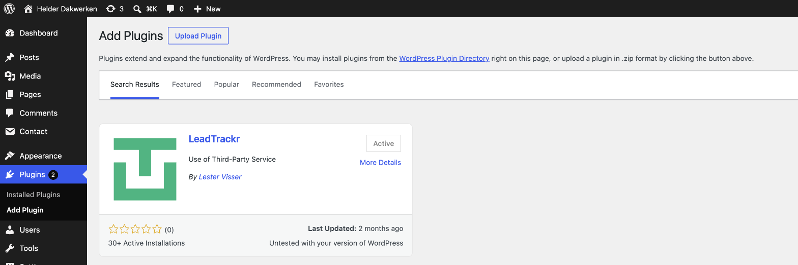
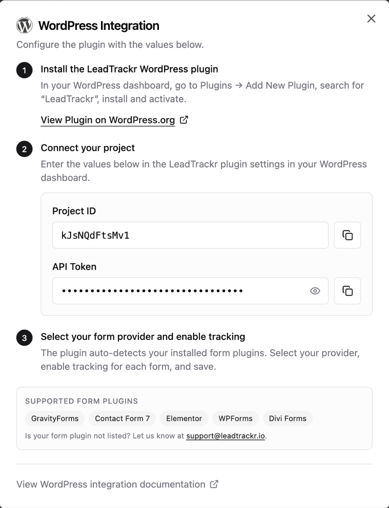
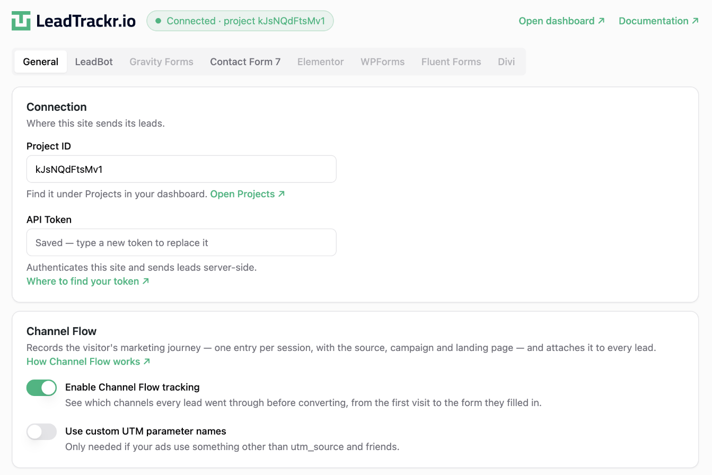
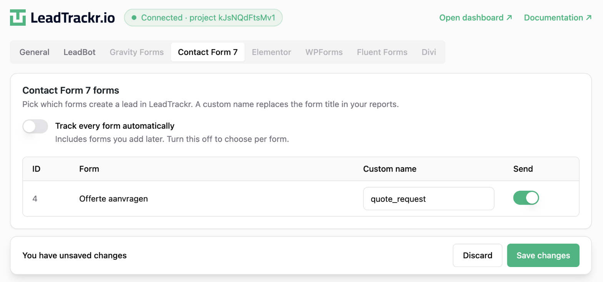

If you're **not using WordPress** or your form provider isn't supported, you can also set up a lead source using [Google Tag Manager (GTM)](/lead-sources/gtm).

<Note>
**Why the WordPress plugin is the recommended setup.** The plugin sends form submissions **server-to-server**, which means:
- 100% of submissions are tracked reliably
- Tracking is not blocked by adblockers, ITP, or browser limitations
- No client-side script is needed to deliver the submission itself (enabling [Channel Flow](/lead-sources/channel-flow-tracker) adds a small first-party script for attribution)
</Note>

Currently supported WordPress form plugins:

- Gravity Forms
- Contact Form 7
- Elementor
- WPForms
- Fluent Forms
- Divi forms

<Info>Is your form plugin not supported yet? Let us know at support@leadtrackr.io, we'd love to hear from you and may add it to our roadmap!</Info>

## Step 1: Install the LeadTrackr Plugin

1. In your WordPress dashboard, go to **Plugins** → **Add Plugin**
2. Search for **LeadTrackr**
3. Click **Install Now**
4. Then click **Activate**

<Frame>
  
</Frame>

Once activated, you'll see **LeadTrackr** appear in your admin menu.

## Step 2: Connect Your Project

To connect your WordPress site to your LeadTrackr project, you need two values: your **project ID** and your **API key**.

1. Go to [app.leadtrackr.io/dashboard/projects](https://app.leadtrackr.io/dashboard/projects)
2. Open the project you want to connect and click **Edit Project**
3. Go to **Lead Sources** and click **WordPress**
4. Copy the **Project ID** and the **API key** (shown as **API Token**)

<Frame>
  
</Frame>

In WordPress, go to **LeadTrackr** in the admin menu and open the **General** tab. Paste the values into the **Project ID** and **API Token** fields under **Connection** and click **Save changes**.

Once both are saved, the status next to the logo shows **Connected** with your project ID.

<Frame>
  
</Frame>

<Warning>
**The API key is required for new installs.** The plugin stays disconnected until both the project ID and the API key are saved. Sites that installed the plugin before the API key was introduced keep working without one, but we recommend adding it.
</Warning>

## Step 3: Choose Which Forms to Track

The plugin has a tab for every supported form plugin. Tabs of form plugins that are not installed on your site are greyed out.

1. Open the tab of your form plugin (e.g. **Contact Form 7**)
2. Choose how you want to track:
    - Turn on **Track every form automatically** to send all forms, including forms you add later
    - Or leave it off and turn on **Send** per form
3. Optionally, give a form a **Custom name**. It replaces the form title in your LeadTrackr reports
4. Click **Save changes**

<Frame>
  
</Frame>

<Note>The form tabs only work once the connection is complete. Until the project ID and API key are saved, they show **Finish the connection first**.</Note>

Your forms are now connected and all new submissions will be sent to LeadTrackr for qualification and conversion tracking.

## Cookies the Plugin Writes

The plugin only writes cookies once you enable **Channel Flow**. Without it, no cookies are set at all.

With Channel Flow on, it writes four first-party cookies on your own domain: `lt_channelflow` and `lt_session` for the channel journey, `lt_consent` to send the visitor's consent status along with the lead, and `lt_probe`, a technical check that is deleted in the same instant it is written.

<Card title="Cookies Used by LeadTrackr" icon="cookie-bite" href="/reference/cookies">
  What each cookie is for, how long it lives and how to classify it in your cookie policy
</Card>

## What's Next?

Nice work, your forms are now connected to LeadTrackr!

Next, set up the [Channel Flow Tracker](/lead-sources/channel-flow-tracker) to capture the full user journey (UTM parameters, landing pages, referrers) alongside your form submissions. The plugin can do this itself — it is a switch under **LeadTrackr** → **General** → **Channel Flow** — so you only need Google Tag Manager for it if you already run a container. Then connect your conversion destinations to start sending offline conversions.

<CardGroup cols={2}>
  <Card title="Set Up Channel Flow Tracker" icon="route" href="/lead-sources/channel-flow-tracker">
    Track the full user journey with UTM parameters
  </Card>
  <Card title="Set Up Google Ads Conversions" icon="google" href="/integrations/google-ads">
    Send offline conversions to Google Ads
  </Card>
  <Card title="Set Up Meta Integration" icon="meta" href="/integrations/meta">
    Send offline conversions to Meta (Facebook)
  </Card>
  <Card title="Set Up GA4 Integration" icon="chart-simple" href="/integrations/ga4">
    Send offline conversions to Google Analytics 4
  </Card>
</CardGroup>
